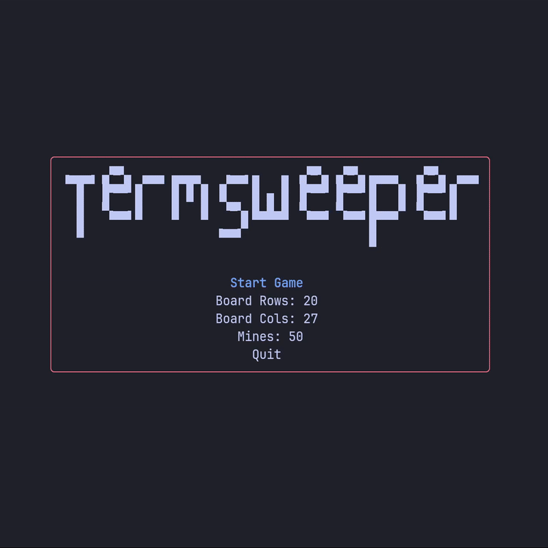
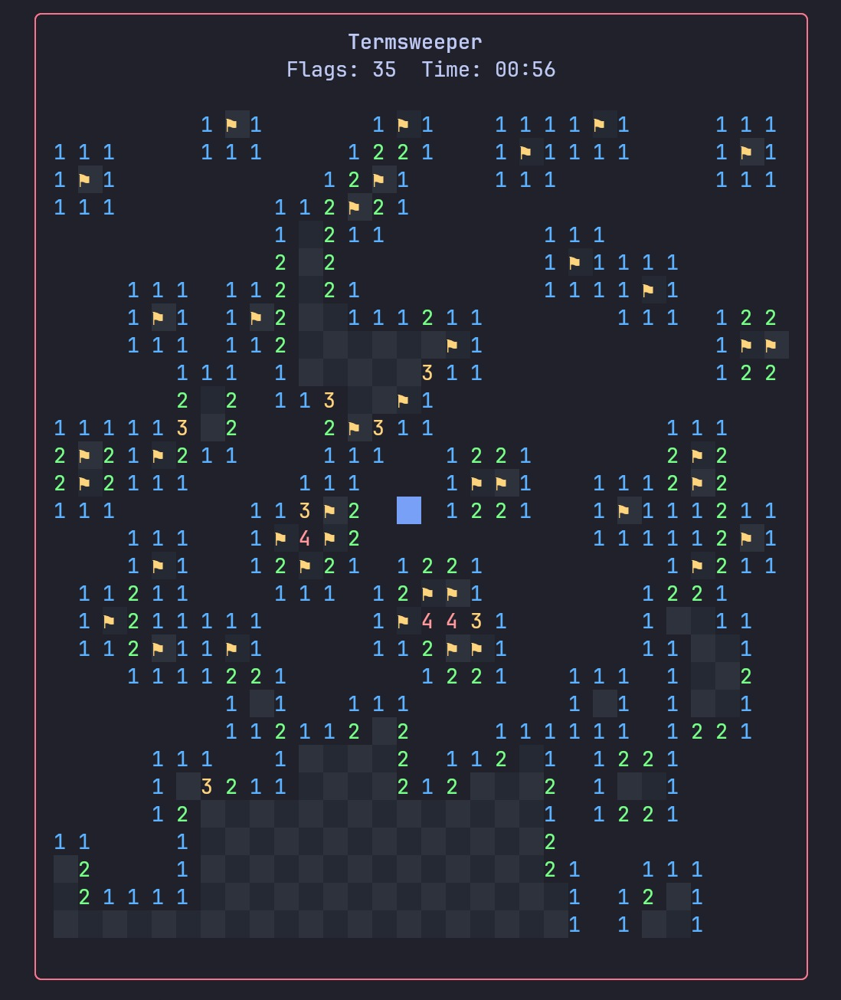
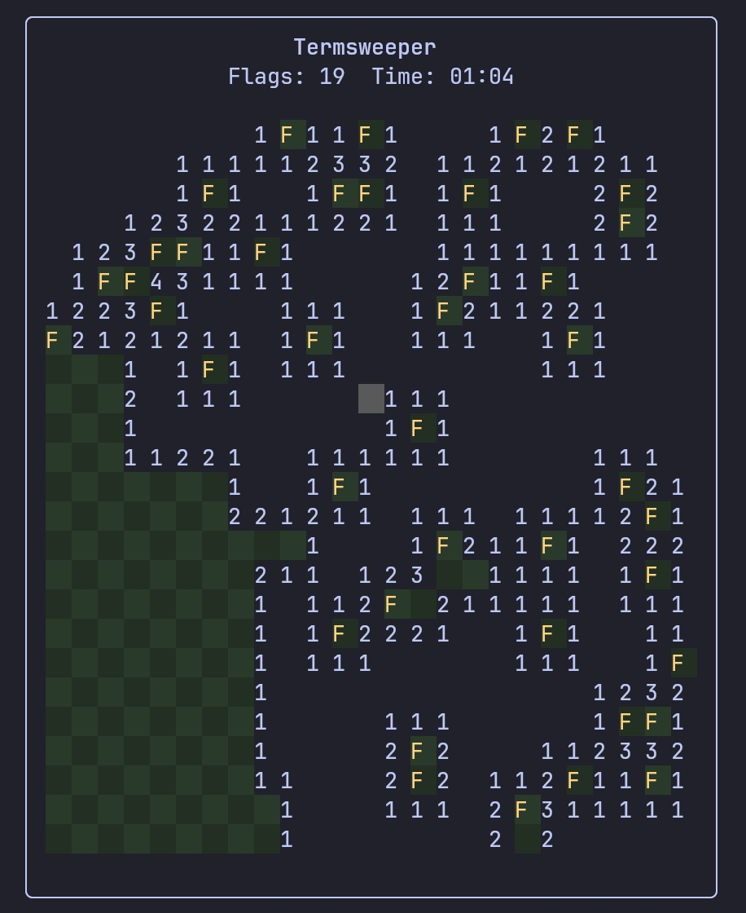

<div align="center">
<pre>
. ▗▄▄▄▖▗▞▀▚▖ ▄▄▄ ▄▄▄▄   ▗▄▄▖▄   ▄ ▗▞▀▚▖▗▞▀▚▖▄▄▄▄  ▗▞▀▚▖ ▄▄▄ .
.   █  ▐▛▀▀▘█    █ █ █ ▐▌   █ ▄ █ ▐▛▀▀▘▐▛▀▀▘█   █ ▐▛▀▀▘█    .
.   █  ▝▚▄▄▖█    █   █  ▝▀▚▖█▄█▄█ ▝▚▄▄▖▝▚▄▄▖█▄▄▄▀ ▝▚▄▄▖█    .
.   █                  ▗▄▄▞▘                █               .
.                                           ▀               .
<strong>Customizable Minesweeper TUI in Go</strong>
</pre>
</div>

TermSweeper is a TUI minesweeper game built with Go and the Bubble Tea TUI framework. It provides a clean, keyboard-driven interface, theming support, and a small set of configurable options.



## Features

- Terminal UI using Bubble Tea and Lip Gloss
- Classic Minesweeper mechanics: reveal, flag, and auto-reveal
- Timer, win/loss detection, and keyboard controls
- Configurable board size, mine count, and display characters
- Boards larger than the terminal scroll with the cursor, with a dashed border on the edges the board continues past
- Optional row/column number labels (absolute or relative) and cursor row/column highlighting
- Multiple color themes (see the Themes directory)

## Getting Started

Prerequisites: Go 1.25 or newer (see `go.mod`)

Clone the repository and run locally:

```bash
git clone https://github.com/vinegm/termsweeper.git
cd termsweeper
go run main.go
```

Or build a standalone binary:

```bash
go build -o termsweeper ./
./termsweeper
```

Command line flags:

- `--version` : print the version and exit
- `--debug` : enable debug logging
- `--debug-file <path>` : write debug logs to the specified file (defaults to `/tmp/termsweeper.log`)

## Configuration

Configuration is read at startup from `$XDG_CONFIG_HOME/termsweeper/config.yaml` (`~/.config/termsweeper/config.yaml` when `XDG_CONFIG_HOME` is unset). The file is optional: anything it leaves out keeps its built-in default (see `internal/config/config.go`), an unparsable or invalid file falls back to the defaults entirely, and a board size or mine count no game can be played on falls back to the default board. An example config is provided at `Themes/example-config.yaml`.

Configurable items include board rows/columns, mine count, characters for mines/flags/unrevealed cells, and many color settings for cells and UI elements.

Boards must be between 5x5 and 1000x1000, with at least one mine and at least one mine-free cell (the first cell revealed is never mined).

## Controls

Use arrow keys or Vim-keys keys to move the cursor. Primary controls:

Movement keys accept a count prefix, like Vim: `5j` moves down five cells, `12l` moves right twelve.

- `R`: Reset the current board
- `F`: Toggle a flag on the highlighted cell
- `Q`: Quit the game (or return to the menu when in-game, where `Continue` resumes it)
- `Space` / `Enter`: Reveal the highlighted cell (or auto-reveal neighbors when applicable)

In the menu, press `Enter` on `Seed` to edit it, type anything (`Backspace` deletes a character), and press `Enter` or `Esc` when done; the same seed, board size, mine count and first move always give the same layout, and an empty seed shows as `random`.

## Themes & Assets

Theme files are stored in the `Themes` directory; several presets are included (catppuccin, dracula, gruvbox, rose-pine, tokyo-night).

### Tokyo Night Theme:



### Default theme:



## Development

```bash
make build   # build the binary
make run     # build and run
make test    # run the test suite
make ci      # format check, vet, lint and test
```

Linting and formatting use [golangci-lint](https://golangci-lint.run/welcome/install/); `make demos` regenerates the demo gif with [vhs](https://github.com/charmbracelet/vhs).

# Contributing

Contributions are welcome! Open issues or pull requests for bugs, improvements, or new themes. If you prefer, feel free to fork the project and customize it for your needs.

## License

This project is licensed under the MIT License, see the [LICENSE](LICENSE) file for details.
